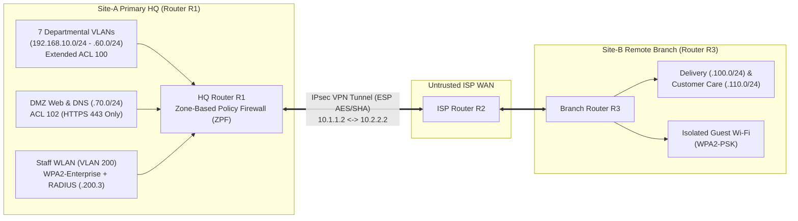

# Network Security Portfolio

Enterprise network security architecture, Cisco Packet Tracer (`.pkt` / `.pka`) topologies, firewall/VPN configurations, and practical network defense labs completed for **Network Security**.

---

## Flagship Project: CloudCafe Multi-Site Enterprise Network Security Architecture

📂 **Location:** [`project-cloudcafe-enterprise-network/`](./project-cloudcafe-enterprise-network/)  
📄 **Full Architecture Report:** [`project-cloudcafe-enterprise-network/ARCHITECTURE_REPORT.md`](./project-cloudcafe-enterprise-network/ARCHITECTURE_REPORT.md)  
🖧 **Cisco Packet Tracer Topology:** [`project-cloudcafe-enterprise-network/cloudcafe-enterprise-network.pkt`](./project-cloudcafe-enterprise-network/cloudcafe-enterprise-network.pkt)

---

## Network Security — Lab Portfolio

All practical network defense implementations and Packet Tracer topologies are organized under [`labs/`](./labs/):

| Lab | Topic | Key Technologies & Protocols | Directory |
| :--- | :--- | :--- | :--- |
| **Lab 03** | Securing Email Communication & Digital Certificates | OpenSSL X.509 Keypair Generation, Public Key Exchange, S/MIME Encrypted Mail, Packet Tracer Topology | [`labs/Lab-03-Securing-Email-Communication-and-Certificates/`](./labs/Lab-03-Securing-Email-Communication-and-Certificates/) |
| **Lab 04** | HTTP Request Interception & Parameter Tampering | Burp Suite Proxy Interception, Price/PID Parameter Manipulation, Wireshark HTTP PCAP Analysis | [`labs/Lab-04-HTTP-Request-Interception-BurpSuite/`](./labs/Lab-04-HTTP-Request-Interception-BurpSuite/) |
| **Lab 05** | Site-to-Site IPsec VPN Implementation | Cisco IOS `securityk9`, ISAKMP Phase 1 Policy, IPsec ESP Transform Sets, Crypto Map Verification | [`labs/Lab-05-Site-to-Site-IPsec-VPN/`](./labs/Lab-05-Site-to-Site-IPsec-VPN/) |
| **Lab 06** | HTTPS Traffic Analysis & MITM Proxying | TLS Certificate Interception, HTTPS Proxy Inspection vs. Direct TLS Handshakes | [`labs/Lab-06-HTTPS-Traffic-Analysis-and-MITM/`](./labs/Lab-06-HTTPS-Traffic-Analysis-and-MITM/) |
| **Lab 07** | Zone-Based Policy Firewall (ZPF) Configuration | Cisco IOS Security Zones (`IN-ZONE`, `OUT-ZONE`), Class-Maps, Stateful `inspect` Policy-Maps, Zone-Pairs | [`labs/Lab-07-Zone-Based-Policy-Firewall-ZPF/`](./labs/Lab-07-Zone-Based-Policy-Firewall-ZPF/) |
| **Lab 08** | Wireless Security: WEP, WPA2-PSK & WPA2-Enterprise | WEP Weakness Analysis, WPA2-PSK vs. 802.1X WPA2-Enterprise RADIUS Server Authentication | [`labs/Lab-08-Wireless-Security-WEP-WPA2-RADIUS/`](./labs/Lab-08-Wireless-Security-WEP-WPA2-RADIUS/) |
| **Lab 09** | Cisco IOS Intrusion Prevention System (IPS) | IOS IPS Signature Storage, `ip ips sdf`, Inline Packet Drop (`deny-packet-inline`) Verification | [`labs/Lab-09-Cisco-IOS-Intrusion-Prevention-System-IPS/`](./labs/Lab-09-Cisco-IOS-Intrusion-Prevention-System-IPS/) |
