# Securing Email Communication & Digital Certificates (OpenSSL & S/MIME)

**Domain:** Network Security  
**Topology:** [`securing_email_topology.pkt`](./securing_email_topology.pkt)

## Overview & Methodology
Demonstrates the difference between unencrypted cleartext mail transfer and cryptographically signed/encrypted email using **OpenSSL** X.509 certificates and public-key cryptography on Linux:
1. **Baseline Cleartext Mail Transfer:** Provisioned local mail accounts (`user1` and `user2`) and dispatched an unencrypted message using the CLI `mail` utility to observe cleartext message storage.
2. **X.509 Keypair & Certificate Generation:** Generated distinct RSA private keys and self-signed X.509 public certificates for both users via `openssl req -x509`.
3. **Public Key Exchange & S/MIME Encryption:** Exchanged public certificates between `user1` and `user2`, encrypted outbound mail payloads against the recipient's public certificate (`openssl smime -encrypt`), and verified decryption using the recipient's private key (`openssl smime -decrypt`).

## Technical Evidence & Screenshots

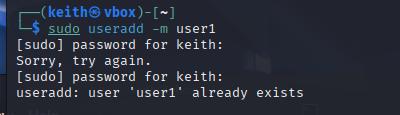

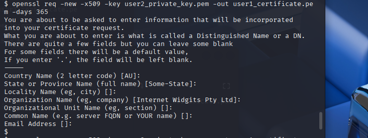

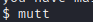

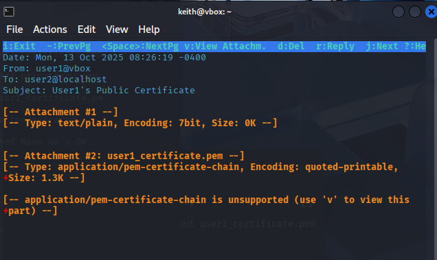

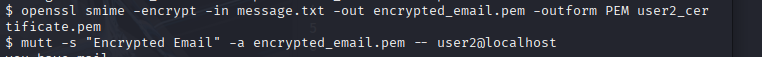

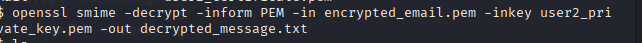

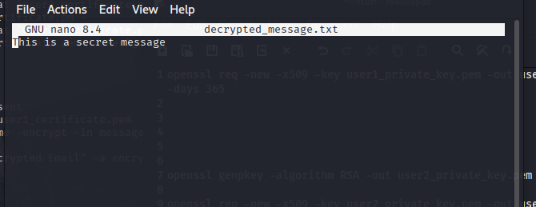

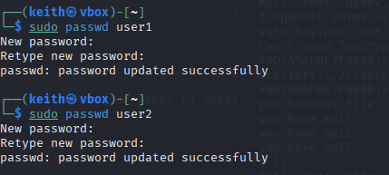

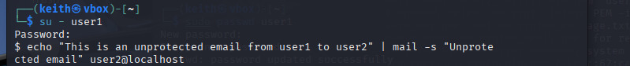

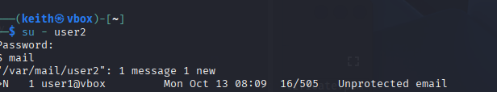

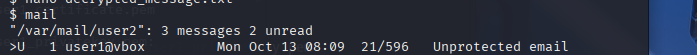

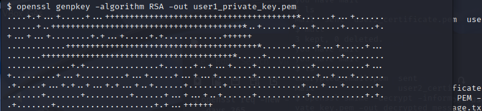

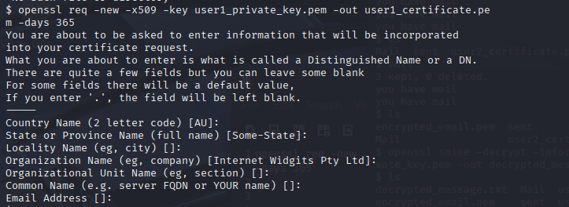

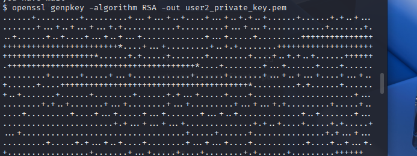
