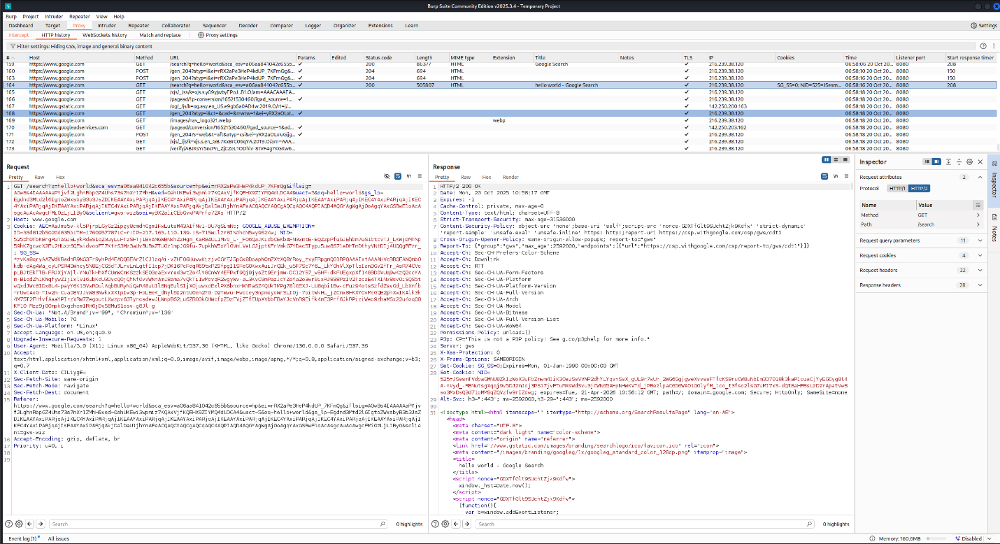
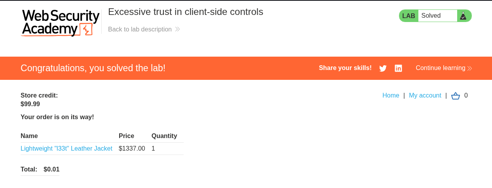
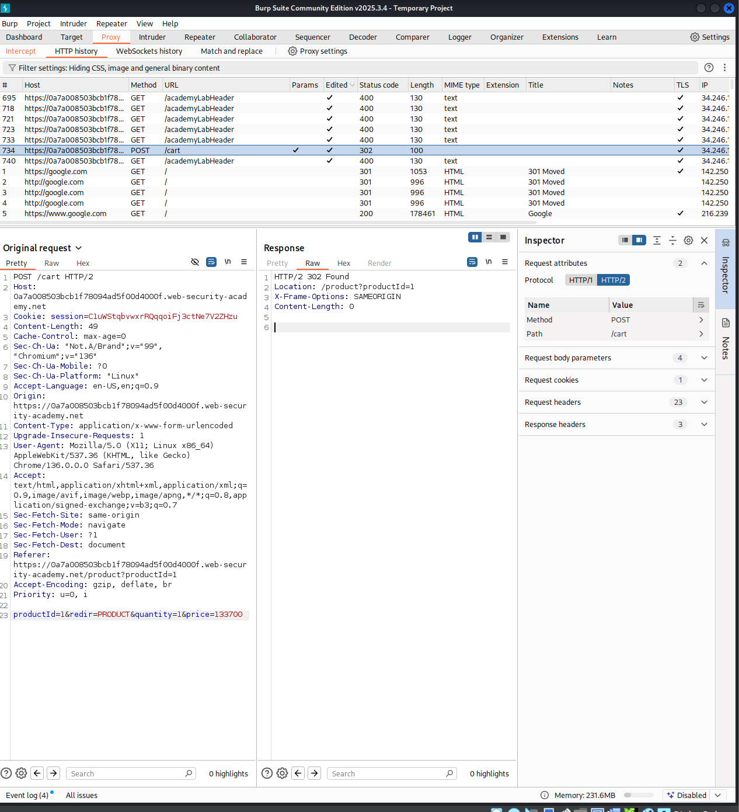
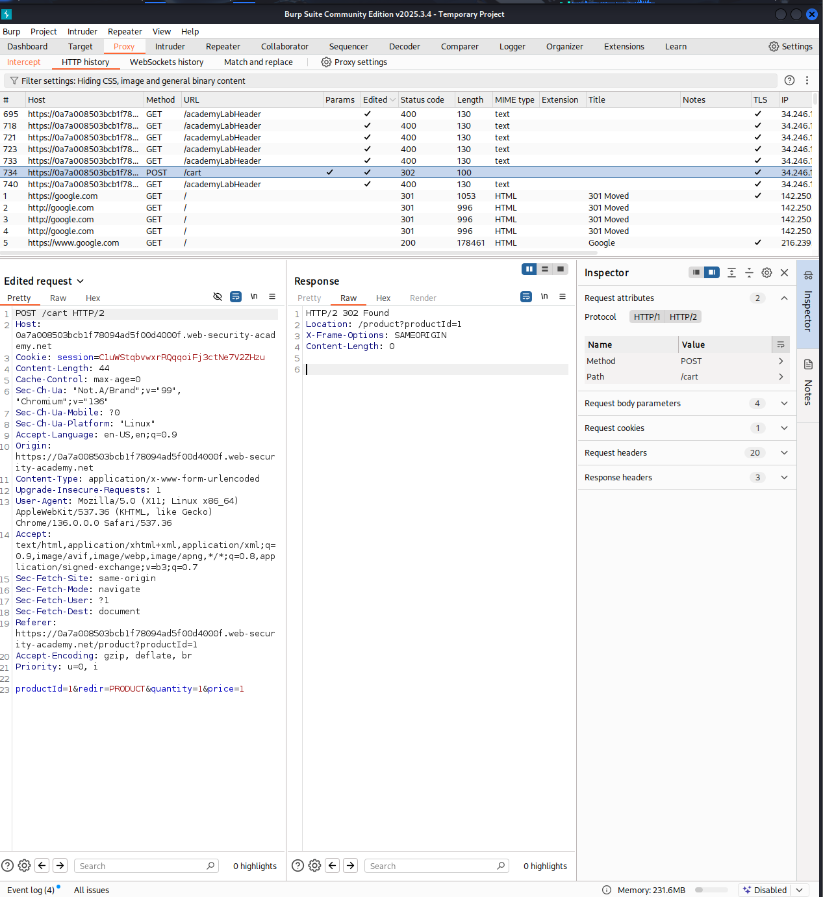
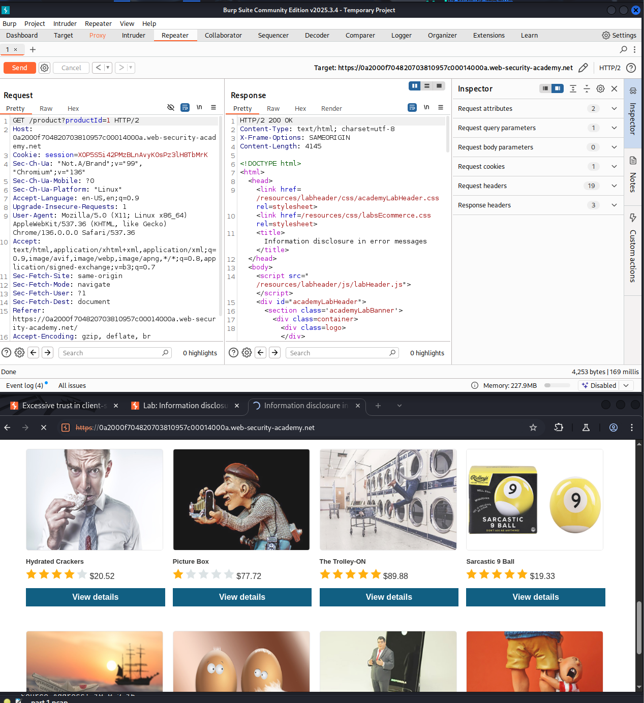
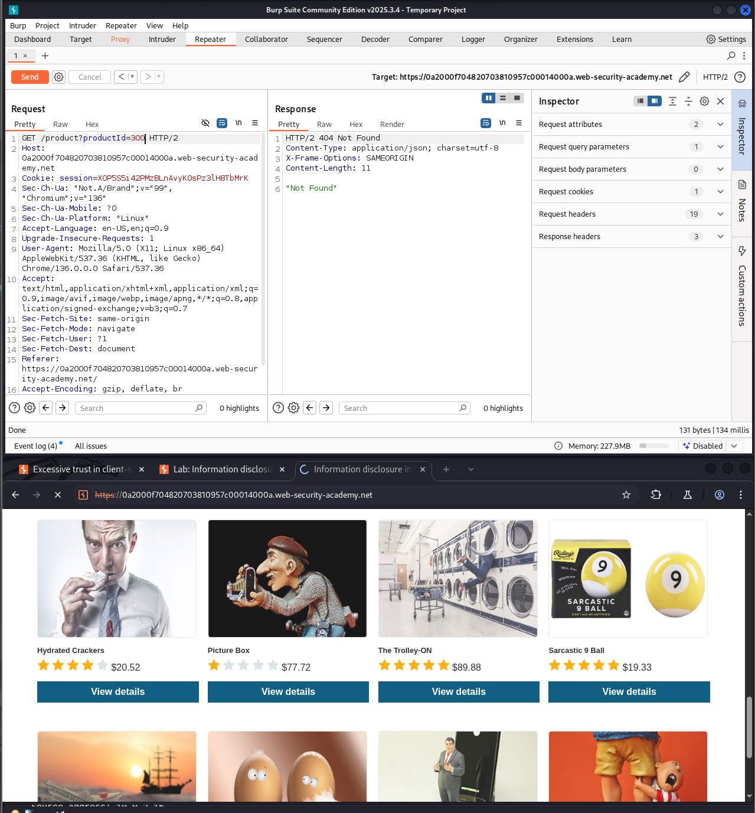
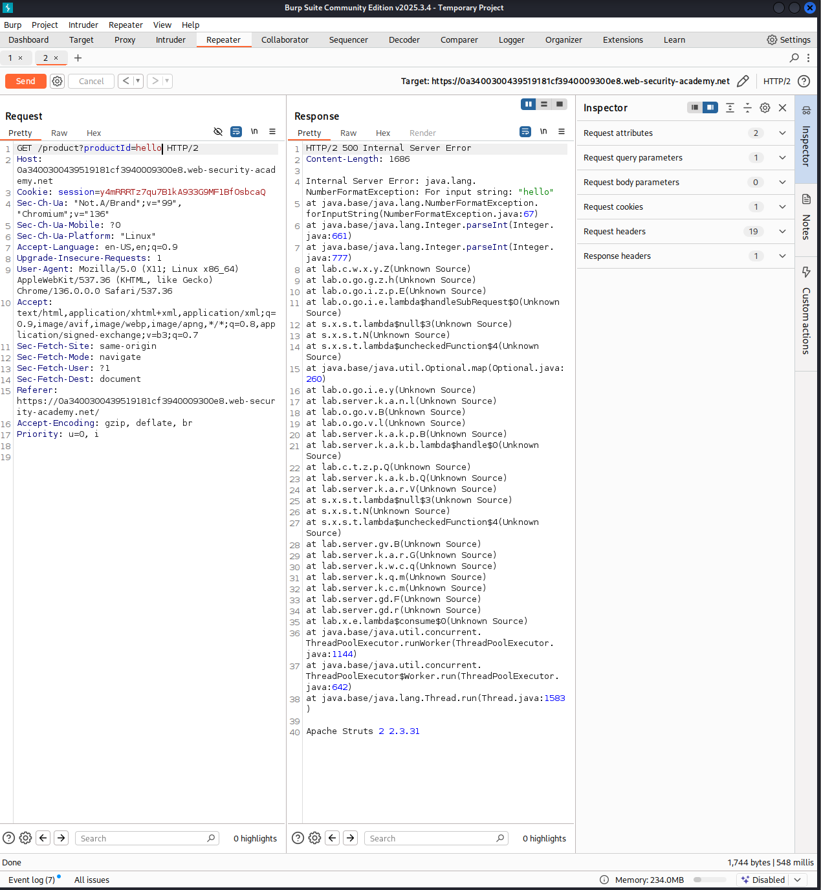
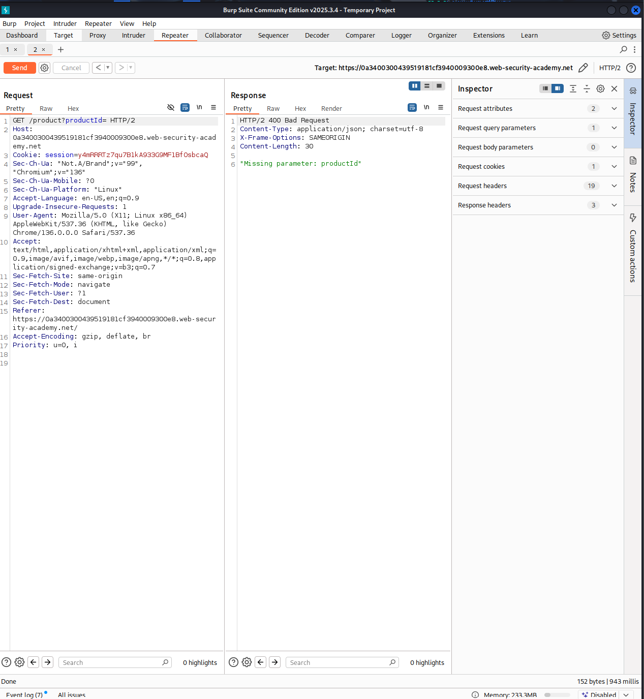

# HTTP Request Interception & Parameter Tampering (Burp Suite & Wireshark)

**Domain:** Network Security  
**Packet Capture:** [`http_intercept_part1.pcap`](./http_intercept_part1.pcap)

## Overview & Methodology
Examines Layer-7 HTTP parameter manipulation vulnerabilities and cleartext HTTP request inspection using **Burp Suite Proxy** and **Wireshark**:
1. **HTTP Traffic Capture:** Captured baseline HTTP GET/POST transactions in Wireshark (`http_intercept_part1.pcap`) to inspect unencrypted form parameters and session headers.
2. **Proxy Interception & Parameter Tampering:** Configured Burp Suite on `127.0.0.1:8080` to intercept client-side product lookup and checkout requests, testing server-side input handling across valid product identifiers, out-of-range identifiers (triggering unhandled HTTP `500 Internal Server Error` stack traces), and missing parameters (`400 Bad Request`).
3. **Remediation Takeaways:** Highlights the necessity of server-side schema validation, parameterized queries, and generic error handling to prevent stack-trace fingerprinting.

## Technical Evidence & Screenshots

