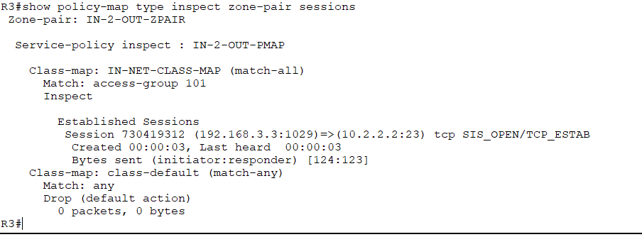
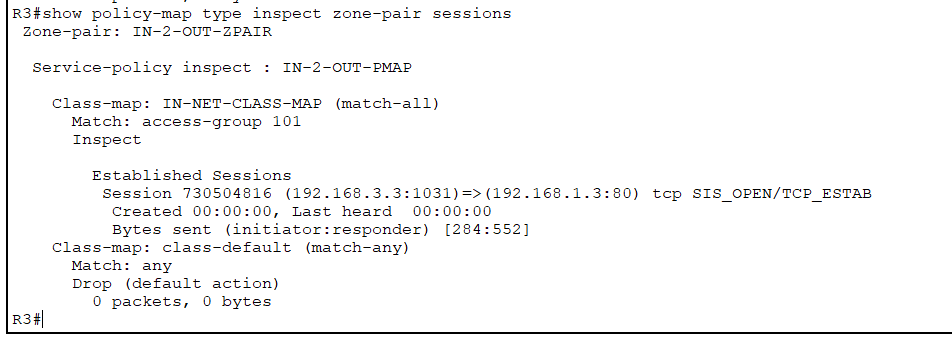

# Configuring a Cisco IOS Zone-Based Policy Firewall (ZPF)

**Domain:** Network Security  
**Packet Tracer Topology:** [`zone_based_policy_firewall.pka`](./zone_based_policy_firewall.pka)

## Overview & Methodology
Implements stateful traffic inspection between an internal corporate LAN (`IN-ZONE`) and an external untrusted network (`OUT-ZONE`) using a Cisco IOS **Zone-Based Policy Firewall (ZPF)**:
1. **Security Zone & Class-Map Definition:** Created `IN-ZONE` and `OUT-ZONE` security zones and defined an Extended ACL / `class-map type inspect` matching internal traffic (`ICMP`, `TCP`, `UDP`).
2. **Stateful Policy-Map & Zone-Pair Binding:** Configured `policy-map type inspect IN-2-OUT-PMAP` with the `inspect` action and bound it to `zone-pair security IN-2-OUT-ZPAIR`.
3. **Stateful Session Verification:** Verified outbound Telnet (`TCP/23`) and HTTP (`TCP/80`) sessions from internal hosts (`192.168.3.3`) while confirming that unsolicited inbound connections from external hosts are dropped by default.

## Technical Evidence & Screenshots

