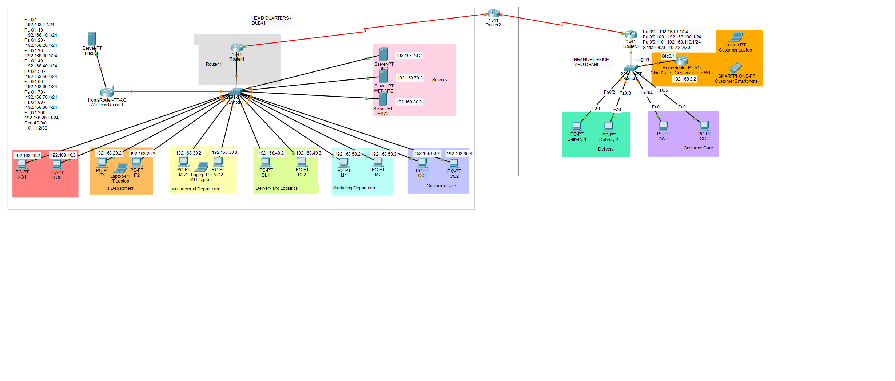
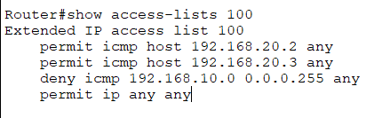
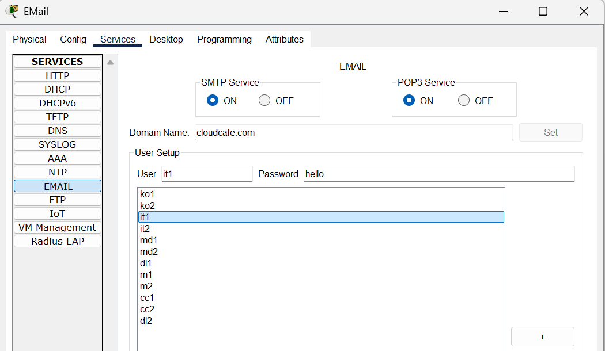
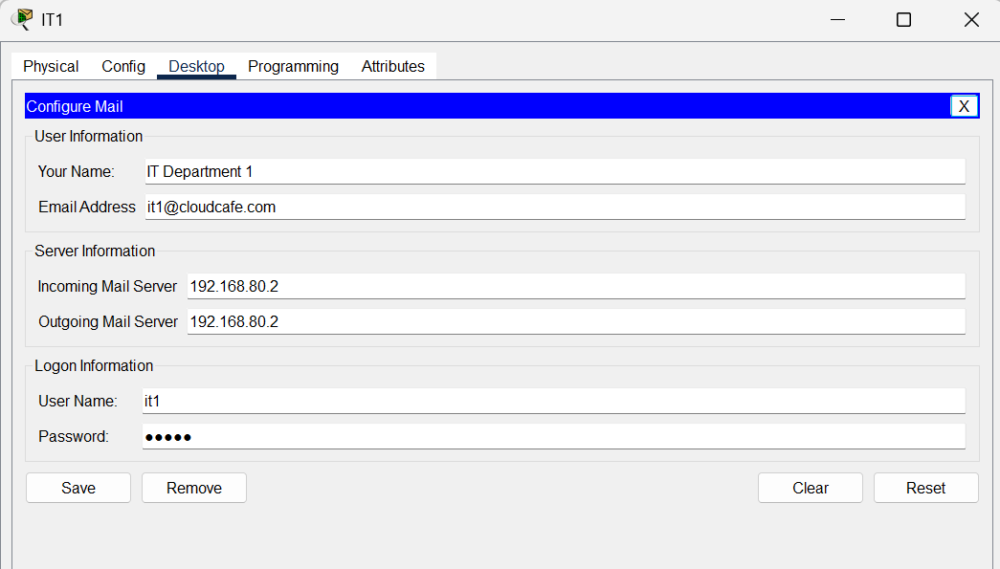
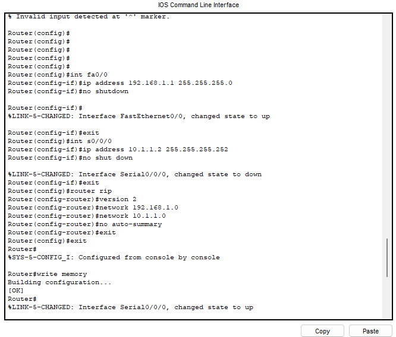
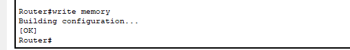
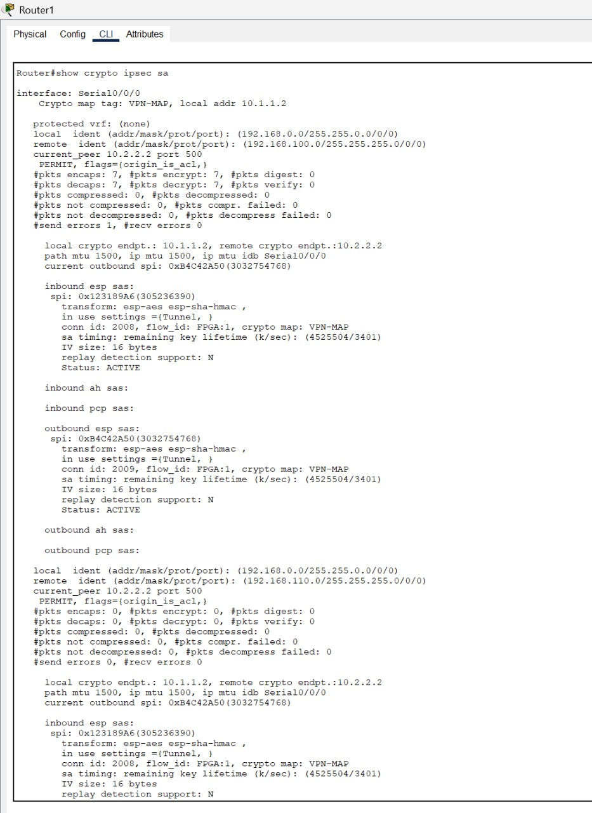
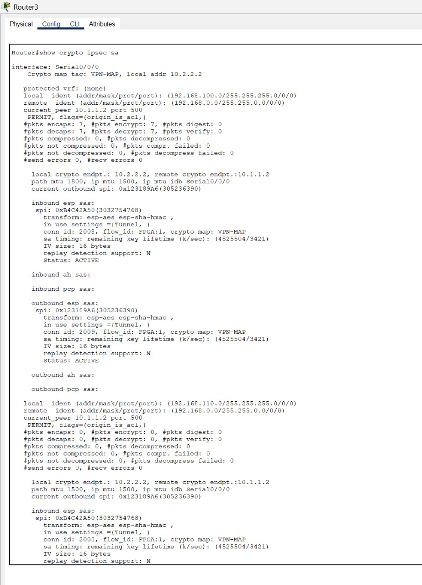
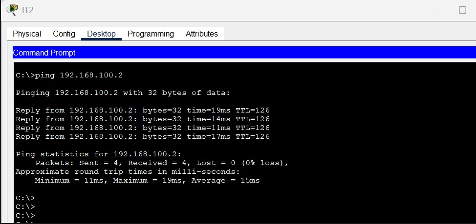
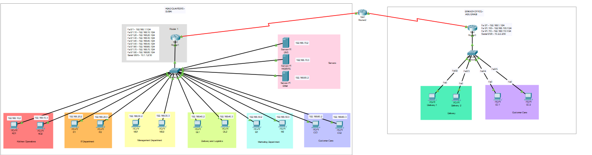

# CloudCafe Multi-Site Enterprise Network Security Architecture
**Domain:** Network Security  
**Packet Tracer Topology:** [`cloudcafe-enterprise-network.pkt`](./cloudcafe-enterprise-network.pkt)

---

## 1. Executive Summary & Company Profile
**CloudCafe** is a multi-site cloud kitchen and digital ordering enterprise operating a primary headquarters at **Site-A HQ (R1)** and a remote retail/fulfillment branch at **Site-B Branch (R3)** connected across an untrusted WAN backbone (**R2**). This project designs and implements an end-to-end defense-in-depth network architecture featuring:
* **Router-on-a-Stick 802.1Q VLAN Segmentation** across 7 departmental security zones.
* **Extended Access Control Lists (ACL 100 & ACL 102)** restricting diagnostic ICMP and enforcing HTTPS-only (`TCP/443`) DMZ web access.
* **Site-to-Site IPsec VPN Tunneling (ESP + AES/SHA)** between Site-A HQ (`R1`) and the Site-B branch (`R3`).
* **Cisco IOS Zone-Based Policy Firewall (ZPF)** stateful inspection (`IN-ZONE` to `OUT-ZONE`).
* **802.1X WPA2-Enterprise (RADIUS)** staff wireless authentication (`VLAN 200`) and isolated **WPA2-PSK** guest Wi-Fi.



---

## 2. Departmental Risk Assessment & VLAN Segmentation

| Business Unit | Security Zone | VLAN / IP Subnet | Assigned Hosts | Criticality & Downtime Tolerance |
| :--- | :--- | :--- | :--- | :--- |
| **Kitchen Operations** | Internal / Operations | `192.168.10.0/24` (`Fa0/0.10`) | `192.168.10.2` – `.3` | **High** (`< 2 hours`) — Direct order fulfillment impact |
| **IT Department** | Management | `192.168.20.0/24` (`Fa0/0.20`) | `192.168.20.2` – `.3` | **High** (`< 1 hour`) — Core infrastructure & diagnostics |
| **Management / Admin** | Internal | `192.168.30.0/24` (`Fa0/0.30`) | `192.168.30.2` – `.3` | **Medium** (`< 2 hours`) — HR, payroll & inventory |
| **Delivery & Logistics** | Internal / Operations | `192.168.40.0/24` (`Fa0/0.40`) | `192.168.40.2` – `.3` | **Medium-High** (`1 day`) — Fleet & dispatch coordination |
| **Marketing** | Internal | `192.168.50.0/24` (`Fa0/0.50`) | `192.168.50.2` – `.3` | **Medium** (`1 day`) — Customer campaigns |
| **Customer Care** | Internal | `192.168.60.0/24` (`Fa0/0.60`) | `192.168.60.2` – `.3` | **Medium** (`4 hours`) — Support ticketing |
| **External / DMZ Services** | External DMZ | `192.168.70.0/24` (`Fa0/0.70`) | DNS: `.70.2`, Web: `.70.3` | **High** (`< 1 hour`) — Public ordering portal (`cloudcafe.example.com`) |
| **HQ Staff WLAN** | Wireless Enterprise | `192.168.200.0/24` (`VLAN 200`) | AP: `.200.1`, RADIUS: `.200.3` | **High** — 802.1X WPA2-Enterprise authenticated Wi-Fi |
| **Site-B Branch LANs** | Remote Branch (R3) | `192.168.100.0/24`, `.110.0/24` | Delivery & Customer Care | **High** — Routed over Site-to-Site IPsec VPN |

---

## 3. Granular Extended ACL Policy & Verification

### Extended ACL 100 (Diagnostic ICMP Lockdown) & ACL 102 (HTTPS DMZ Enforcement)
```ios
! Allow ICMP diagnostics exclusively from authorized IT management hosts
access-list 100 permit icmp 192.168.20.2 0.0.0.0 any
access-list 100 permit icmp 192.168.20.3 0.0.0.0 any
access-list 100 deny icmp any any

! Permit HTTPS (TCP 443) only to the DMZ Web Server (192.168.70.3)
access-list 102 permit tcp any host 192.168.70.3 eq 443
access-list 102 deny ip any any
```



---

## 4. Email & Web Hardening Architecture
* **Email Authentication Triad:** SPF, DKIM cryptographic signing, and staged DMARC enforcement (`p=none` -> `p=quarantine` -> `p=reject`).
* **Encrypted Mail Transport:** Enforced TLS 1.2/1.3 across SMTPS (`465`), Submission (`587`), IMAPS (`993`), and POP3S (`995`), blocking cleartext IMAP (`143`) and POP3 (`110`).
* **PKI & TLS Certificate Lifecycle:** ACME automated certificate renewal (< 398-day validity ceiling), HSM/locked-permission private key storage, and CRL/OCSP revocation workflows.




---

## 5. Multi-Site WAN & Site-to-Site IPsec VPN (`R1 <-> R2 <-> R3`)

To interconnect **Site-A HQ (`R1`, WAN `10.1.1.2`)** and the **Site-B Branch (`R3`, WAN `10.2.2.2`)** across the untrusted ISP router (`R2`), an **IPsec Site-to-Site VPN** was deployed:
* **Confidentiality:** AES / 3DES payload encryption inside ESP tunnels.
* **Integrity & Authentication:** SHA-1 HMAC packet verification and IKE Pre-Shared Key authentication between `10.1.1.2` and `10.2.2.2`.






---

## 6. Zone-Based Policy Firewall (ZPF) & Wireless 802.1X RADIUS
* **Stateful ZPF (`IN-2-OUT-ZPAIR`):** Binds `IN-ZONE` (Internal VLANs) to `OUT-ZONE` (External WAN) via `IN-2-OUT-PMAP`, inspecting outbound sessions and dropping unsolicited inbound WAN traffic by default.
* **Staff WPA2-Enterprise (`VLAN 200`):** WRT300N AP at `192.168.200.1` authenticating against a dedicated **RADIUS Server (`192.168.200.3`)** with AES encryption.
* **Guest WPA2-Personal (Site-B Branch):** Isolated guest SSID on `192.168.3.0/24` preventing lateral movement into corporate subnets.




